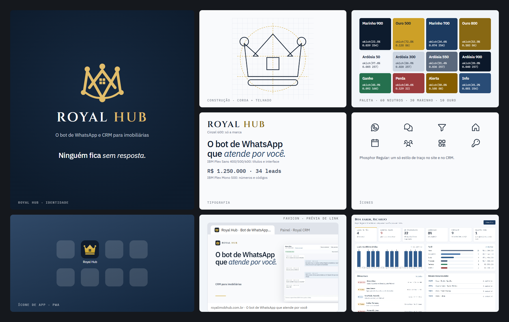
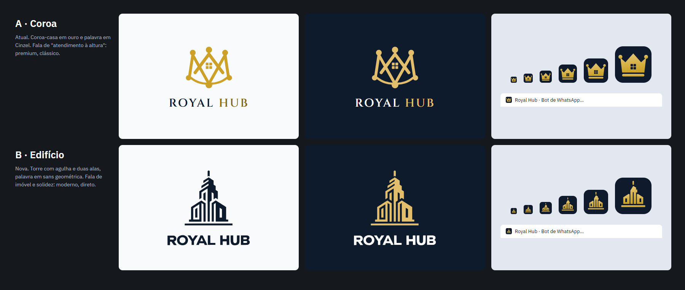

# Etapa 4 — Identidade visual

## Estratégia

- **Categoria:** CRM para imobiliárias com um bot de WhatsApp que atende pelo corretor.
- **Público:** donos e gerentes de imobiliária, que querem parecer premium para o cliente final, e corretores que usam o sistema o dia todo.
- **Promessa:** ninguém fica sem resposta; a equipe só entra quando vale a pena.
- **Metáfora (mantida):** coroa + casa. "Royal" é o atendimento à altura do imóvel; a casa é o negócio.
- **Evitar:** brasão falso, excesso de dourado e "luxo" genérico.

## Logo

| Peça | Uso | Arquivo |
|---|---|---|
| **Marca completa:** coroa-casa com pérolas + "ROYAL HUB" em Cinzel | cabeçalhos, login, rodapé, materiais (≥ 24px de altura) | `src/app/shared/ui/marca.ts` (`<app-marca>`), original em `public/logo-royal.webp` |
| **Símbolo compacto (novo):** coroa de três pontas cuja ponta central é um telhado com beiral, com a janela de quatro vidros | favicon, ícone de app, avatar de perfil (16–512px) | `public/favicon.svg`, fonte em `simbolo-compacto.svg` |

O logo original **não mudou**. O símbolo compacto é uma redução dele: tira as pérolas da base e os arcos, que somem abaixo de 32px, e engrossa o telhado para a casa continuar legível em 16px. O "HUB" da palavra passou a usar `--cor-marca-texto`, para ter contraste AA no fundo claro.

Área de respiro: pelo menos a altura da janela (¼ do símbolo) em volta. Não deformar, não aplicar sombra, não trocar o ouro por outra cor. Sobre fotos, use sempre o símbolo no quadrado marinho.

## Paleta final

São os primitivos da [etapa 2](../etapa-2/TOKENS.md), sem mudança de valor:

| Proporção | Cores | Papel |
|---|---|---|
| ~60% | ardósia 50–300 (claro) / marinho 950–900 (escuro) | fundo e superfícies |
| ~30% | marinho 900 e 700, ardósia 550–900 | texto, ação, áreas da marca |
| ~10% | ouro 300 / 500 / 800 | só a marca, o fio dourado e o anel de destaque. **Nunca** botão ou estado. |

Estados (ganho, perda, alerta, info) existem só para informar, nunca para decorar.

## Tipografia

| Fonte | Peso | Onde |
|---|---|---|
| **Cinzel** | 600 | Só a marca (a palavra "ROYAL HUB"). **Decisão:** os títulos das telas do CRM saem do Cinzel e vão para Plex Sans 600 na etapa 5 (era o ponto M3 da auditoria). |
| **IBM Plex Sans** | 400 / 500 / 600, itálico 400 | Títulos, interface, página inicial. O itálico marca a ênfase ("*atende por você*"). |
| **IBM Plex Mono** | 400 / 500 | Valores em tabela, códigos de imóvel, telefones. |

Todas são self-hosted (`@fontsource`, subset latin) desde a etapa 3.

## Ícones

**Phosphor Regular** (`@phosphor-icons/core`, já instalado): um só estilo de traço, cobre WhatsApp, funil, casa, agenda, QR code e chave. Substitui as setas de texto (← →) e os SVGs desenhados à mão. A troca nas telas entra na etapa 5, num componente `<app-icone>`.

## Favicon, PWA e compartilhamento

| Arquivo | Tamanho | Uso |
|---|---|---|
| `public/favicon.svg` | vetor | navegadores modernos |
| `public/favicon.ico` | 16 / 32 / 48 | navegadores antigos, atalhos do Windows |
| `public/icons/apple-touch-icon.png` | 180 | iPhone, "Adicionar à Tela de Início" (já ligado no `index.html`) |
| `public/icons/icone-192.png`, `icone-512.png` | 192 / 512 | manifest da PWA (`purpose: any`) |
| `public/icons/icone-maskable-192.png`, `-512.png` (+ `.svg`) | 192 / 512 | manifest (`purpose: maskable`), com o desenho dentro da zona segura de 80% |
| `public/og.jpg` | 1200×630 | prévia de link no WhatsApp e redes sociais, agora com o símbolo |

O `manifest.webmanifest` e o service worker entram na etapa 6 (`ng add @angular/pwa`), já apontando para esses ícones.

## Logo B: edifício (alternativa)

Vetorizado do arquivo enviado (`logo-edificio-original.webp`) com potrace, sem redesenhar. É uma torre com agulha e duas alas, sobre a linha do chão, com a palavra "ROYAL HUB" em sans geométrica.

| Peça | Arquivo |
|---|---|
| Símbolo (vetor fiel ao original) | `public/marca/edificio-simbolo.svg` |
| Palavra | `public/marca/edificio-palavra.svg` |
| Símbolo compacto (16–512px) | `public/marca/edificio-compacto.svg` (fonte: `simbolo-edificio-compacto.svg`) |
| Favicon, ICO, apple-touch e PWA (normal e maskable) | `docs/redesign/etapa-4/icones-edificio/` |

O componente `<app-marca>` já desenha as duas versões (`variante="coroa" | "edificio"`). No edifício, a cor segue o tema: marinho no claro, ouro e branco no escuro.

**A ou B, qual escolher:**
- **A (coroa):** "Royal" literal, atendimento premium. Combina com o ouro e o Cinzel.
- **B (edifício):** fala de imóvel na hora, é mais moderno, e a palavra em sans conversa com a home V3. O símbolo é mais fino e pede o compacto abaixo de 60px.

**Para trocar para o B (duas mudanças):**
1. Em `src/app/shared/ui/marca.ts`, troque `MARCA_PADRAO` para `'edificio'`.
2. Copie `docs/redesign/etapa-4/icones-edificio/*` por cima de `public/` (`favicon.svg` e `favicon.ico` na raiz, o resto em `public/icons/`) e refaça o `og.jpg`.
